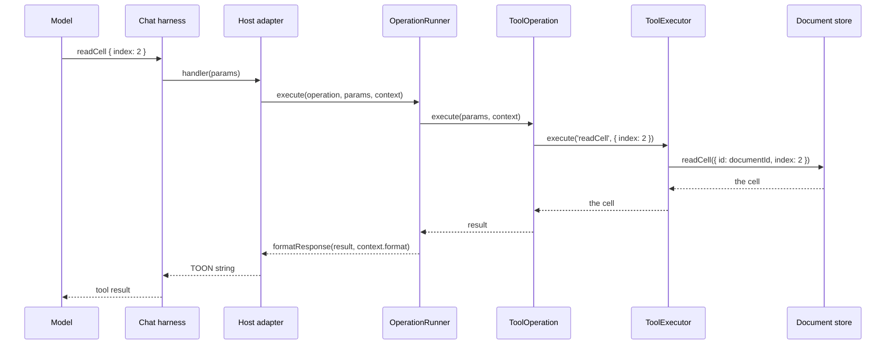

# `@datalayer/reactor/tools`

A document host — a notebook, a Lexical document, a deck, a sheet, an arena —
has operations a model should be able to run: read a cell, insert a block, say
where the ball is. Each host used to describe those in its own shape, and each
chat harness adapted each shape on its own. `@datalayer/reactor/tools` is one
vocabulary for all of them: what a tool *is*, how it *runs*, where its work is
*done*, how its result *reads*, how its parameters are *described*, and how a
tool that *streams* pushes its events.

It was the core of `@datalayer/jupyter-react/tools`, moved here on 6 November
2026. jupyter-react re-exports it and keeps the notebook's own definitions,
operations and schemas; jupyter-lexical and the agent-runtimes adapters import
it from here. The plugins' command bundles — the `AgentTools` contribution
point on the [previous page](/agent-tools/) — stay in the reactor's core: a
bundle says which of a plugin's *commands* a model may call; this machinery is
how a host's *document* tools are defined, run, adapted and streamed.

| Export | What it is |
| --- | --- |
| `ToolDefinition`, `ToolConfig`, `ToolParameters` | one tool, as a model is told it and as a host runs it |
| `ToolOperation`, `ToolExecutionContext` | the operation behind a definition, and the context it runs in |
| `ToolExecutor`, `DefaultExecutor` | where an operation's work is done |
| `OperationRunner`, `formatResponse` | running one operation and formatting what it answers |
| `ToolStreamEvent`, `ToolStreamPush`, `ToolStreamStop` | the streaming contract |
| `zodToToolParameters`, `validateWithZod` | parameters described from a Zod schema, and validated with it |

## A tool, for a host

A `ToolDefinition` is one tool, said once. This is the notebook's `readCell`,
as `@datalayer/jupyter-react` defines it:

```ts
import type { ToolDefinition } from '@datalayer/reactor/tools';
import { zodToToolParameters } from '@datalayer/reactor/tools';

export const readCellTool: ToolDefinition = {
  name: 'datalayer_readCell',
  displayName: 'Read Notebook Cell',
  toolReferenceName: 'readCell',
  description:
    'Reads a specific cell from a Jupyter notebook by index, including source code and outputs',
  parameters: zodToToolParameters(readCellParamsSchema),
  operation: 'readCell',
  config: {
    confirmationMessage: (params: { index: number }) => `Read cell at index ${params.index}?`,
    invocationMessage: (params: { index: number }) => `Reading cell ${params.index}`,
    requiresConfirmation: false,
    canBeReferencedInPrompt: true,
    priority: 'high',
  },
  tags: ['cell', 'notebook', 'read', 'inspect'],
};
```

| Field | Meaning |
| --- | --- |
| `name` | the vendor-prefixed tool name, `datalayer_readCell` |
| `displayName` | how the tool is shown |
| `toolReferenceName` | the name a person refers to it by, `readCell`; the agent-runtimes adapter gives the model this name, and falls back to `name` |
| `description` | what the model is told |
| `parameters` | the JSON Schema of what it takes, a [`ToolParameters`](#how-parameters-are-typed) |
| `operation` | the name of the `ToolOperation` that does it; a host pairs the two by this name |
| `config` | a `ToolConfig`: `confirmationMessage` and `invocationMessage` built from the parameters, `requiresConfirmation`, `canBeReferencedInPrompt`, a `priority` for ranking, and whatever a platform adds — the type has an index signature for that |
| `tags` | categorization tags |
| `streams` | the tool [streams](#how-streaming-results-flow): its call returns at once and the host keeps pushing events |

A definition says nothing about *how* the tool runs — that is the operation's
— and nothing about *which harness* calls it — that is the adapter's. That is
what lets one definition serve both the agent-runtimes chat and CopilotKit.

## The lifecycle of an operation

A `ToolOperation` is the work behind a definition, paired with it by name:

```ts
interface ToolOperation<TParams, TResult> {
  /** Matches ToolDefinition.operation */
  name: string;
  execute(params: TParams, context: ToolExecutionContext): Promise<TResult>;
  /** Only for an operation that streams; see below */
  subscribe?(params: TParams, context: ToolExecutionContext, push: ToolStreamPush): Promise<ToolStreamStop> | ToolStreamStop;
}
```

A host keeps its definitions in an array and its operations in a record keyed
by name, `Record<string, ToolOperation<unknown, unknown>>`; an adapter walks the
definitions and looks each one's `operation` up in the record. An operation
does not reach into a store itself: it goes through the context's executor.
The smallest one that is complete:

```ts
import type { ToolOperation } from '@datalayer/reactor/tools';

const readCell: ToolOperation<{ index: number }, unknown> = {
  name: 'readCell',
  execute: (params, context) => context.executor.execute('readCell', params),
};
```

The notebook's real `readCell` does more in `execute` before it reaches the
executor — validates its parameters, reads the cells to check the index is in
range, answers `{ success: false, error }` when it is not — and then calls
`context.executor.execute(this.name, { index, includeOutputs })`. The point
holds: the operation decides *what* to do, the executor is *where* it is done.

One call, from the model to the store and back:



`OperationRunner.execute(operation, params, context)` is the one line an
adapter calls: it runs the operation and hands its result to `formatResponse`.
It logs nothing. It once printed the operation, its parameters, the whole
context and the result on every call; the context carries `extras`, which is
where platforms put SDK handles and credentials, so that was both unreadable
and a way for a token to end up in a browser console. A caller that wants to
watch tool traffic wraps the executor, which sees the same calls without the
context.

## The execution context

Every `execute` and `subscribe` receives a `ToolExecutionContext`:

| Field | Meaning |
| --- | --- |
| `executor` | the `ToolExecutor` the operation does its work through; the only required field |
| `documentId` | which document: a file URI or a document UID, the same for a notebook or a Lexical document |
| `format` | how the result goes back: `'json'` for the object itself, `'toon'` for a string |
| `extras` | whatever a platform needs beside: SDK handles, credentials, a session |

A host builds one context per document and shares it across that document's
tools; agent-runtimes memoizes it on `documentId` so the tools array stays
stable while the document changes underneath.

## The executor

A `ToolExecutor` is one method, `execute(operationName, args)`: a store, a
bridge to another process, or a mock. `DefaultExecutor` is the executor over a
store whose methods *are* the operations:

```ts
import { DefaultExecutor, type ToolExecutionContext } from '@datalayer/reactor/tools';

const store = {
  readCell: ({ id, index }: { id: string; index: number }) => ({ id, index, source: 'print(1)' }),
};

const context: ToolExecutionContext = {
  executor: new DefaultExecutor('doc-1', store),
  documentId: 'doc-1',
};
```

`execute('readCell', { index: 2 })` calls `store.readCell({ id: 'doc-1', index: 2 })`:
the store's method of the operation's name, with one payload object, the
document's id first and the arguments spread after it. A name the store has no
function for is refused: `Store method 'nothing' not found or not a function`.

This is how a host *adapts its own tool calls*: it does not rewrite its store
for the model. The notebook hands `DefaultExecutor` its Zustand store, whose
`readCell`, `insertCell` and the rest already take `{ id, ... }`; the Lexical
document brings its own executor with the same `execute` signature. An
operation written against `context.executor` runs on either.

## How results read

`formatResponse(data, format)` is what the runner answers with. `'json'`
returns the object as it is. Anything else — the default, since most tool
calls are a model's — encodes it as [TOON](https://github.com/toon-format/toon),
which a model reads more easily than JSON. The adapters below ask for
`'toon'` explicitly, so a harness that expects a string gets one.

## How streaming results flow

Most tools answer once. An arena that keeps telling a contestant where the
ball is cannot wait to be asked, so the contract has a second shape:

- the definition says `streams: true`;
- the operation has a `subscribe(params, context, push)` beside its `execute`,
  which starts pushing events for one call and returns how to stop;
- `execute` still answers the call itself — *subscribed*, or the first state.

```ts
import type { ToolOperation, ToolStreamEvent } from '@datalayer/reactor/tools';

const watch: ToolOperation<{ every: number }, { subscribed: true }> = {
  name: 'arena_watch',
  execute: async () => ({ subscribed: true }),
  subscribe: (params, _context, push) => {
    let tick = 0;
    const timer = setInterval(
      () => push({ source: 'arena-pong', tick: ++tick, at: Date.now(), says: `tick ${tick}` }),
      params.every,
    );
    return () => clearInterval(timer);
  },
};
```

Each event is a `ToolStreamEvent`:

| Field | Meaning |
| --- | --- |
| `source` | what pushed it: the arena's id, `arena-pong` |
| `tick` | the source's own clock, when it has one |
| `at` | when it was pushed, in milliseconds |
| `says` | the state in words a model acts on |
| `state` | the same state as data, when there is more than the words |

`OperationRunner.subscribe(operation, params, context, push)` is the adapter's
side: it returns the `ToolStreamStop`, and refuses in a sentence an operation
that has no `subscribe` — `Operation 'readCell' does not stream: it has no
subscribe.` What a harness does with the events is its own business; the
agent-runtimes chat tells the model each one as a turn it did not ask for.
The first streaming tool is a Pong arena's `arena_watch`.

## How parameters are typed

`ToolDefinition.parameters` is a `ToolParameters`:

```ts
type ToolParameters = {
  type: 'object';
  properties: Record<string, unknown>;
  required?: string[];
};
```

A type literal, deliberately, not an interface. A host that takes any JSON
Schema types its parameters `Record<string, unknown>`; a type literal is
assignable to that, an interface without an index signature is not. The
agent-runtimes frontend tools refused the interface, and that is why it
changed.

### From a Zod schema

A host writes the schema once, with Zod, and derives the JSON Schema from it:

```ts
import { z } from 'zod';
import { zodToToolParameters, validateWithZod } from '@datalayer/reactor/tools';

export const readCellParamsSchema = z.object({
  index: z.preprocess(
    val => (typeof val === 'string' ? parseInt(val, 10) : val),
    z.number().int().nonnegative().describe('Cell index (0-based)'),
  ),
  includeOutputs: z.boolean().optional().describe('Whether to include cell outputs in the response (default: true)'),
});

zodToToolParameters(readCellParamsSchema);
// { type: 'object',
//   properties: { index: { type: 'number', description: 'Cell index (0-based)' },
//                 includeOutputs: { type: 'boolean', description: '…' } },
//   required: ['index'] }
```

`zodToToolParameters` converts an object schema by hand, so that it reads Zod
v3 and v4 alike. What the model sees is this JSON Schema and nothing else, so
the structure survives rather than flattening to `string`:

- an object's properties and `required` list, recursively; an array's `items`;
  a union as `anyOf`, except a union of literals of one type, which is an
  `enum`; enums, literals, records (an `object`, saying nothing about keys
  nobody named);
- `.optional()` and `.default()` make the field not required; `.nullable()`
  keeps `null` beside the type; `.readonly()` is peeled off;
- `.preprocess()`, `.refine()` and `.transform()` are read by the schema the
  input is read with — the `index` above is a `number`, not a string;
- `.describe()` is kept wherever it sits, the outermost one winning;
- `z.any()` and `z.unknown()` are left typeless; a construct it does not know
  is promised as a `string`; nesting stops at six levels.

A schema that is not an object falls back to `zod-to-json-schema`.

`validateWithZod(schema, params, operationName)` is the other half, for an
operation's `execute`: it parses, and on failure throws one error a model can
act on, with the Zod error as its `cause`:

```
Invalid parameters for readCell:
  - index: Expected number, received string

Received: {"index":"two"}
```

The Zod error is read by its shape — it carries `issues` — not by
`instanceof`, so a schema made by another copy of Zod than the reactor's is
refused the same way.

## A host adapter, from agent-runtimes

The agent-runtimes chat takes `frontendTools`, each a `FrontendToolDefinition`
with a `name`, a `description`, `parameters` as any JSON Schema, a `handler`,
and for a streaming tool `streams` and `subscribe`. Its adapter turns a
definition and its operation into one of those. Trimmed of its duplicate-call
cache and its repair of parameters a model sent as JSON strings, it is this:

```ts
import type { ToolDefinition, ToolOperation, ToolExecutionContext } from '@datalayer/reactor/tools';
import { OperationRunner } from '@datalayer/reactor/tools';
import type { FrontendToolDefinition, ToolStreamEvent } from '../../../types/tools';

export function createAgentRuntimesTool(
  definition: ToolDefinition,
  operation: ToolOperation<unknown, unknown>,
  context: ToolExecutionContext,
): FrontendToolDefinition {
  const runner = new OperationRunner();

  return {
    name: definition.toolReferenceName || definition.name,
    description: definition.description,
    parameters: definition.parameters,
    // A tool that streams: subscribed through its operation, its events
    // pushed to the harness until stopped.
    ...(definition.streams && operation.subscribe
      ? {
          streams: true,
          subscribe: (params: unknown, push: (event: ToolStreamEvent) => void) =>
            runner.subscribe(operation, params, context, push),
        }
      : {}),

    handler: async (params: unknown): Promise<unknown> => {
      try {
        // TOON: a string the model reads
        return await runner.execute(operation, params, { ...context, format: 'toon' });
      } catch (error) {
        return { success: false, error: error instanceof Error ? error.message : String(error) };
      }
    },
  };
}

export function createAllAgentRuntimesTools(
  definitions: ToolDefinition[],
  operations: Record<string, ToolOperation<unknown, unknown>>,
  context: ToolExecutionContext,
): FrontendToolDefinition[] {
  const tools: FrontendToolDefinition[] = [];
  for (const definition of definitions) {
    const operation = operations[definition.operation];
    if (!operation) {
      console.warn(`No operation found for ${definition.name} (operation: ${definition.operation})`);
      continue;
    }
    tools.push(createAgentRuntimesTool(definition, operation, context));
  }
  return tools;
}
```

Three things to notice. The adapter passes `definition.parameters` through
untouched, which is what the type literal is for. A streaming tool is only
adapted as one when both halves agree — the definition says `streams` and the
operation has `subscribe`. And an error becomes a result, not a thrown
exception, so the model reads what went wrong and tries again.

A notebook's tools, then, are the notebook's definitions and operations, the
`DefaultExecutor` over its store, and this adapter (trimmed of a type cast):

```ts
import { DefaultExecutor, type ToolExecutionContext } from '@datalayer/reactor/tools';
import { notebookStore, notebookToolDefinitions, notebookToolOperations } from '@datalayer/jupyter-react';

export function createNotebookTools(documentId: string): FrontendToolDefinition[] {
  const executor = new DefaultExecutor(documentId, notebookStore.getState());
  const context: ToolExecutionContext = { documentId, executor, format: 'toon' };
  return createAllAgentRuntimesTools(notebookToolDefinitions, notebookToolOperations, context);
}
```

The CopilotKit adapter beside it is the same shape against a different
harness: it rewrites the JSON Schema into CopilotKit's parameter array, and
since CopilotKit expects a string back, asks the runner for TOON. Neither
adapter knows what a notebook is.

## Where it lives

`@datalayer/reactor/tools` is the `./tools` entry of the package's `exports`
and `typesVersions`; nothing in it needs React or a reactor. `zod` is an
optional peer dependency (`>=3.23`), needed only by `zodToToolParameters` and
`validateWithZod`; `zod-to-json-schema` and `@toon-format/toon` are
dependencies. Its tests are under `src/tools/__tests__`, run with `vitest`.
