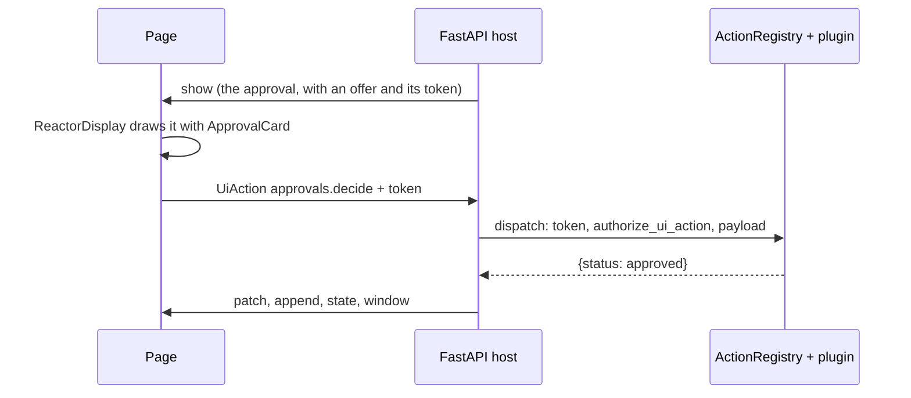

# The approval card example

`examples/ui-channel` — the whole [`reactor.ui`](/ui-channel/) loop at its
smallest. A Python host shows an approval card; a React page draws it with the
renderer a plugin contributed; the person presses Approve; the press comes back
with the token the server minted, past a plugin's veto, to a handler that
patches the card.



## Run it

From the repository root, with the reactor installed (`pip install -e .`):

```bash
uvicorn --app-dir examples/ui-channel ui_channel_example.server:app --port 8791
```

and in another terminal:

```bash
cd examples/ui-channel && npm install && npm run dev     # http://localhost:5181
```

Request an approval with the form, then press Approve or Reject on its card.

- Press as `ada` on a request `ada` made: the plugin vetoes it (`403`,
  `UiActionRefused`).
- Press again on a card already decided: the desk answers `409`. The offer is
  gone from the card, but the token still checks — late presses are the
  handler's to refuse.
- The right-hand column is what a model is told: no reviewer's note, no
  history, no comment typed with the decision. The vendor key is in neither
  column — it never leaves the server.
- Below the session, a `mcp.request_approval` tool result is drawn with the
  same renderer through a tool binding, and a display no plugin claims is drawn
  as its text.

## What is in it

| File | What it shows |
| --- | --- |
| `ui_channel_example/approval.py` | `@display_type` `Approval`: a page-only note and history, a `SecretStr`; the `Decide` payload with a page-only comment; `ApprovalPlugin` with `provide_display_types` and `authorize_ui_action` |
| `ui_channel_example/desk.py` | The host without HTTP: `ActionRegistry.register` / `offer` / `dispatch`, a `MemoryUiChannel`, and the ops a decision emits |
| `ui_channel_example/server.py` | The desk over FastAPI, with `UiActionError` mapped to its `status_code` |
| `ui_channel_example/scripted.py` | One scripted session, recorded to `fixtures/demo-ops.json` |
| `src/approvalPlugin.ts` | A lazy renderer and a tool binding, as contributions |
| `src/ApprovalCard.tsx` | The renderer, pressing through `act` |
| `src/App.tsx` | `useUiChannel`, `ReactorDisplay`, the press with the offered token |

The display:

```python
@display_type(APPROVAL_TYPE, version=1)
class Approval(Display):
    title: str
    amount_eur: float
    requester: str
    status: Literal["pending", "approved", "rejected"] = "pending"
    reviewer_note: Annotated[str, audience("page")] = ""
    history: Annotated[list[str], audience("page")] = []
    vendor_key: SecretStr | None = None

    def text(self) -> str:
        return f"{self.title}: {self.amount_eur:.2f} EUR for {self.requester} ({self.status})"
```

The veto — a requester cannot decide their own request:

```python
class ApprovalPlugin:
    def provide_display_types(self, registry: DisplayRegistry) -> None:
        registry.register(Approval)

    def authorize_ui_action(self, principal, session, action: UiAction) -> bool | None:
        if action.action != DECIDE:
            return None
        approval = self._desk.get(action.display_id)
        return approval is None or approval.requester != principal
```

What a decision emits:

```python
ui.patch(self.channel, session, approval.id, [
    {"op": "replace", "path": "/data/status", "value": approval.status},
    {"op": "replace", "path": "/text", "value": approval.text()},
    {"op": "replace", "path": "/actions", "value": []},
])
ui.append(self.channel, session, approval.id, "/data/history", line)
ui.state(self.channel, session, [{"op": "add", "path": "/last_decision", "value": {...}}])
ui.window(self.channel, session, "notify", message=f"{approval.title} {approval.status}")
```

On the page, the press — the renderer names the action, the host adds the
display id and the offered token:

```tsx
const actOn = (display: Display): UiAct => async (action) => {
  const offer = display.actions?.find((candidate) => candidate.name === action.action);
  if (!offer) return;
  return sendAction(principal, { ...action, display_id: display.id, token: offer.token });
};
```

## Test it

```bash
pytest examples/ui-channel/tests -q
npx vitest run examples/ui-channel/src
```

The two tiers test the same session. `scripted.py` records one — two
approvals, one approved — to `fixtures/demo-ops.json`:

- the Python test checks the file is still what the desk emits, and drives the
  round trip: the wire carries the page-only fields and never the secret, the
  model view carries neither, a forged or misplaced token is `403`, the
  requester's own press is vetoed, a repeated `idempotency_id` runs once, and
  the HTTP routes answer `403`, `422` and `409`;
- the TypeScript tests resolve the renderer (version 1 only; gone when the
  plugin is disabled) and the tool binding, replay the file through the
  reducer, refuse a prototype pointer, and press Approve on a rendered card.

Both run in CI with the rest of the suite. After changing what the desk emits,
record the session again:

```bash
python examples/ui-channel/ui_channel_example/scripted.py > examples/ui-channel/fixtures/demo-ops.json
```
