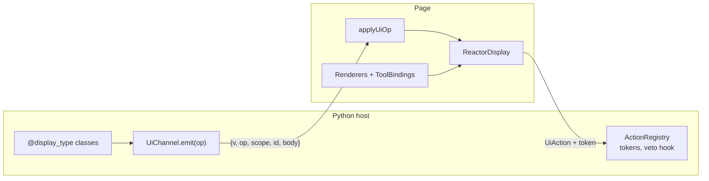

# UI channel

A Python host tells a page what to show; the page shows it and sends back what
the person pressed. `reactor.ui` is that data plane, with one versioned wire
contract and a half on each tier:

- **Python** — `reactor.ui`: the envelope and its ops, typed displays, typed
  actions with minted tokens, an AG-UI encoder, the JSON Schema.
- **TypeScript** — `@datalayer/reactor/ui`: the wire types, the renderer
  registry and tool bindings, a pure reducer.
- **React** — `@datalayer/reactor/ui/react`: `<ReactorDisplay>` and
  `useUiChannel`.



## The envelope

Every op is `{ "v": 1, "op", "scope", "id", "body" }`:

| op | body | does |
| --- | --- | --- |
| `show` | a display | shows it, or replaces the one of the same id |
| `patch` | RFC 6902 operations | changes one display (`/text`, `/data/...`) |
| `append` | `{ path, value }` | pushes onto an array in one display |
| `remove` | — | removes one display |
| `state` | RFC 6902 operations | changes the scope's shared state |
| `ask` | a display | shows a question, remembered as waiting |
| `window` | `{ name, args }` | a message for the host window; not state |
| `meta` | an object | merges facts about the scope |

`scope` is what an op belongs to (a session, a thread): one stream can carry
several. The pydantic models in `reactor.ui.wire` are canonical;
`schema/reactor-ui.v1.schema.json` is generated from them and the TypeScript
types follow it. A drift test on each tier fails when one moves without the
others.

```bash
reactor ui schema --out schema/reactor-ui.v1.schema.json
```

## Displays

A display is a typed payload with a MIME-like type, a version, and a text
every display must have — what a page with no renderer shows, and what a
transcript keeps.

```python
from typing import Annotated
from pydantic import SecretStr
from reactor.ui import Display, audience, display_type

@display_type("application/vnd.example.weather+json", version=1)
class Weather(Display):
    city: str
    celsius: float
    note: Annotated[str, audience("page")] = ""   # the person sees it, the model does not
    api_key: SecretStr | None = None              # neither does

    def text(self) -> str:
        return f"{self.city}: {self.celsius} °C"

Weather(city="Ghent", celsius=9).wire()        # what the page receives
Weather(city="Ghent", celsius=9).model_view()  # what a model is told
```

On the wire the class's own fields are `data`:

```json
{ "type": "application/vnd.example.weather+json", "version": 1, "id": "…",
  "text": "Ghent: 9.0 °C", "data": { "city": "Ghent", "celsius": 9.0, "note": "" },
  "actions": [] }
```

Audiences are applied once, at the wire boundary: `both` (the default) for the
page and the model, `page` for the person only, and secrets for neither. The
same `model_view()` applies to action payloads, so what a person types on the
page reaches the model through it or not at all.

A plugin declares its types with the `provide_display_types(registry)` hook;
`PluginPlatform.display_types()` gathers those of the enabled plugins into one
registry, which parses a wire display back into its class and lists every
type's schema.

## Renderers and tool bindings

On the page, a plugin that draws a type contributes a renderer for it:

```tsx
import { contribution, definePlugin } from '@datalayer/reactor';
import { Renderers } from '@datalayer/reactor/ui';
import { defineRenderer } from '@datalayer/reactor/ui/react';

export const WeatherPlugin = definePlugin({
  name: '@example/weather',
  contributes: [
    contribution(
      Renderers,
      defineRenderer({
        type: 'application/vnd.example.weather+json',
        versions: { min: 1, max: 1 },
        load: () => import('./WeatherCard'),
      }),
    ),
  ],
});
```

Several plugins may claim one type: among those whose version range admits the
display, the highest `rank` wins, then the one registered first. Disabling a
plugin takes its renderers with it. Every plugin keeps its own renderer — none
has to draw another's types.

```tsx
<ReactorDisplay display={display} act={act} context={hostContext} />
```

draws a display with the renderer that claims it (lazily, behind Suspense and
an error boundary), and its text when none does. The renderer receives
`{ display, act, context }`: `context` is whatever the host hands its
renderers — a chat passes the tool call.

### Tool results

A tool result is a display one of two ways, in this order:

1. It carries one in `_meta["reactor.ui/display"]` — an MCP tool result says
   exactly what it is.
2. A plugin bound the tool's name to a type in `ToolBindings`:

   ```ts
   contribution(ToolBindings, { tool: /(^|[_.:\-/])pap_sign_in$/, type: 'application/vnd.datalayer.pap.sign-in+json' })
   ```

   The raw result is wrapped as a display of that type, with
   `data: { toolName, result }`.

`resolveToolResult(platform, { toolName, result, toolCallId })` answers the
display, or `undefined` — and then the host draws the call its own way.

## Actions

Only what a display offered can be pressed. The server registers an action
with the model of its payload, offers it on a display with a token minted for
the session, the display and the action, and dispatches what comes back:

```python
from reactor.ui import ActionRegistry, UiAction

actions = ActionRegistry(secret, platform=platform)
actions.register("weather.refresh", Refresh, refresh, plugin="weather")

weather.actions = [actions.offer(session, weather.id, "weather.refresh", label="Refresh")]
...
result = await actions.dispatch(principal, session, UiAction.model_validate(body))
```

- An action nobody registered is `UnknownUiAction` (`status_code = 422`); it
  is never turned into anything else.
- A token minted for another session, display or action is
  `UiActionTokenInvalid` (403).
- Every enabled plugin's `authorize_ui_action(principal, session, action)` is
  asked; any `False` vetoes (`UiActionRefused`, 403), and so does a hook that
  raises.
- A payload that does not validate is `UiActionPayloadInvalid` (422).
- A press repeating an `idempotency_id` gets the first answer; the handler
  runs once.

The reactor ships no route: a host maps `UiActionError.status_code` in its own
exception handler.

## Channels and AG-UI

A producer only ever calls `emit(op)` on a `UiChannel`; the host decides the
transport. `MemoryUiChannel` keeps ops for tests and replays, and
`reactor.ui.channel` has a helper per op (`show`, `patch`, `append`, …).

For a page that already reads an AG-UI stream, `reactor.ui.agui.encode_agui`
(optional `ag-ui-protocol`) maps `show` to `ACTIVITY_SNAPSHOT`, `patch` and
`append` to `ACTIVITY_DELTA`, `state` to `STATE_DELTA`, and anything else to
a `CUSTOM` event named `reactor.ui`.

On the page, `applyUiOp(model, op)` is a pure reducer — RFC 6902 for `patch`
and `state` — and `useUiChannel({ scope })` keeps a model in a component:

```tsx
const { model, emit } = useUiChannel({ scope: sessionId, onWindow });
return orderedDisplays(model).map((d) => <ReactorDisplay key={d.id} display={d} />);
```

The reducer fails fast: an op of another wire version, or a patch against a
display never shown, throws.
