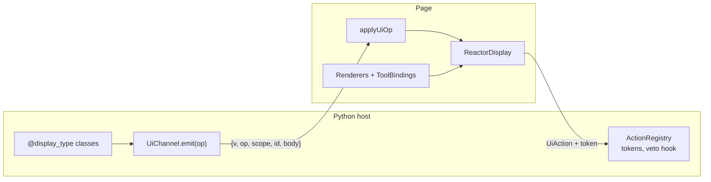

# UI channel

A Python host tells a page what to show; the page shows it and sends back what
the person pressed. Without a contract, every feature invents that exchange
again: a hand-named event per message, a tool call faked to draw a card, one
renderer slot the host owns and every plugin fights over, and a button that
posts whatever the page decides to post.

`reactor.ui` is that exchange, written down once — one typed, versioned wire
between a Python host and the page, with a half on each tier:

| Tier | Import | What it holds |
| --- | --- | --- |
| Python | `reactor.ui` | the envelope and its ops, typed displays with audiences, typed actions with minted tokens, the AG-UI encoder, the JSON Schema |
| TypeScript | `@datalayer/reactor/ui` | the wire types and guards, the renderer registry and tool bindings, a pure reducer |
| React | `@datalayer/reactor/ui/react` | `<ReactorDisplay>`, `defineRenderer`, `useUiChannel` |

The Python half needs nothing beyond pydantic (the AG-UI encoder is an
optional extra); the TypeScript half has no React in it.



## Four ideas

**One envelope.** Everything the host says is an op —
`{ "v": 1, "op", "scope", "id", "body" }` — and there are eight of them:
`show`, `patch`, `append`, `remove`, `state`, `ask`, `window`, `meta`. The
page keeps what they say with one pure reducer. See
[Channel ops and the reducer](/ui-channel/channel-ops).

**Displays with a text.** A display is a typed payload: a MIME-like type, a
version, its data, and a text every display must have. A page with no renderer
for the type draws the text; a transcript keeps it; a model reads it. Each
field says who it is for — the page and the model, the page only, or (a
secret) neither — and that is applied once, where the display leaves Python.
See [Displays and audiences](/ui-channel/displays).

**Renderers keyed by type.** On the page, a plugin draws a type by
contributing a renderer for it. Several may claim one type; rank and version
range decide. A tool result becomes a display too, by carrying one or by a
plugin binding the tool's name to a type. See
[Renderers and tool bindings](/ui-channel/renderers).

**Actions back, with tokens.** Only what a display offered can be pressed: the
server mints a token for the session, the display and the action when it
offers it, and checks it when the press comes back — then asks every plugin,
then validates the payload. See [Actions](/ui-channel/actions).

## What a model sees

The same display has two views, and the host picks one by who it is talking
to:

```python
from typing import Annotated
from pydantic import SecretStr
from reactor.ui import Display, audience, display_type

@display_type("application/vnd.example.weather+json", version=1)
class Weather(Display):
    city: str
    celsius: float
    note: Annotated[str, audience("page")] = ""   # the person sees it, the model does not
    api_key: SecretStr | None = None              # neither does

    def text(self) -> str:
        return f"{self.city}: {self.celsius} °C"

weather = Weather(city="Ghent", celsius=9, note="Bring a coat", api_key="k-123")
weather.wire()        # what the page receives: city, celsius, note
weather.model_view()  # what a model is told: the text, city, celsius
```

```python
>>> weather.model_view()
{'type': 'application/vnd.example.weather+json', 'text': 'Ghent: 9.0 °C',
 'data': {'city': 'Ghent', 'celsius': 9.0}}
```

## In this section

- [Displays and audiences](/ui-channel/displays) — `@display_type`, the wire form,
  `model_view`, the registry and the `provide_display_types` hook.
- [Renderers and tool bindings](/ui-channel/renderers) — `Renderers`, `ToolBindings`,
  `ReactorDisplay`, `resolveToolResult`.
- [Channel ops and the reducer](/ui-channel/channel-ops) — the eight ops, `UiChannel`,
  `applyUiOp`, `useUiChannel`, and the JSON Patch rules.
- [Actions](/ui-channel/actions) — tokens, the `authorize_ui_action` hook, idempotency,
  and the errors a route answers with.
- [AG-UI](/ui-channel/agui) — the ops as AG-UI events, for a page that already reads an
  AG-UI stream.
- [Schema and types](/ui-channel/schema) — the JSON Schema, and how the TypeScript types
  are kept in step.
- [Security](/ui-channel/security) — what never reaches a model, and what the page may
  send.

The [approval card example](/examples/ui-channel/) runs the whole loop: a
FastAPI host, a React page, a press with a veto, and tests on both tiers.
