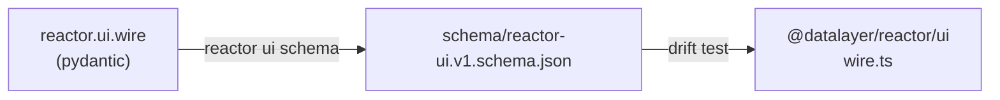

# Schema and types

The pydantic models in `reactor.ui.wire` are the definition of the wire. The
other two forms follow from them, and a test on each tier fails when one moves
without the others.



## The JSON Schema

```bash
reactor ui schema                                          # print it
reactor ui schema --out schema/reactor-ui.v1.schema.json   # write the committed copy
```

The schema is JSON Schema 2020-12, with the `$id`
`https://reactor.datalayer.tech/schema/reactor-ui.v1.schema.json`. Its root
is `UiOp` — one op of the envelope, a `oneOf` with `op` as the discriminator —
and its `$defs` hold every op, every patch operation, `DisplayWire`,
`ActionOffer`, `FileRef` and `UiAction`, the message going the other way.

From Python:

```python
from reactor.ui.schema import render_schema, ui_wire_schema, write_schema

ui_wire_schema()["$defs"]["UiAction"]["required"]   # ['action', 'display_id', 'token']
```

`tests/test_ui_schema.py` regenerates the schema and compares it with the
committed file: a model changed without regenerating fails there.

## The TypeScript types

`@datalayer/reactor/ui` declares the same types by hand (`Display`, `UiOp`,
`PatchOperation`, `UiAction`, …), and `UI_WIRE_FIELDS` lists every property of
every type by its schema name — the compiler checks each name is a key of its
type. `src/ui/__tests__/wire.test.ts` reads the committed schema and checks:

- `UI_WIRE_FIELDS` names every object definition of the schema, and only those;
- each definition's properties are exactly the schema's;
- `UI_OP_NAMES` is exactly what the discriminator maps.

So a field added in Python is refused twice until it is in the schema and in
the TypeScript types.

## A change to the wire

1. Change the models in `reactor/ui/wire.py`.
2. `reactor ui schema --out schema/reactor-ui.v1.schema.json`.
3. Follow it in `src/ui/wire.ts` — the type, `UI_WIRE_FIELDS`, and the
   guards (`isDisplay`, `isPatchOperation`, `isUiOp`) when the shape of an
   op changes.

A change a page of the current version cannot read is a new wire version:
`UI_WIRE_VERSION` and the schema's file name move together, and the reducer
refuses an op of another version.

## Display types

Each display type has a schema of its own, from its pydantic class:

```python
platform.display_types().schemas()
# {'application/vnd.example.approval+json@1': {'properties': {...}, 'title': 'Approval', ...}}
```

A host serves it for whatever needs to know a type's data — a renderer's
author, a form generator, a model told what a display may contain. The
renderers on the page read `display.data` as their plugin knows it; nothing
generates TypeScript per display type.
